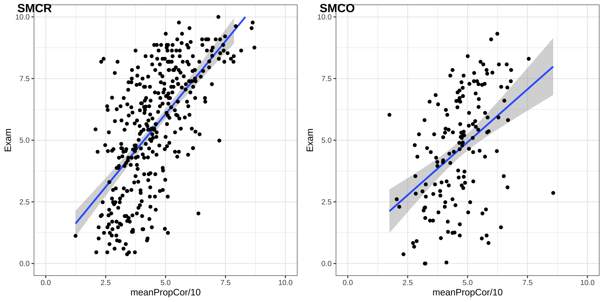

# {background-image="Here-Be-Dragons-animation.gif" background-size="contain"}

# Course setup {.smaller}

::: {style="font-size: 0.7em;"}

We have structured the course with clear chronological learning activities. On a weekly basis, we expect you to engage with the course materials in the following way:

1. Read the [book](https://shklinkenberg.github.io/Statistical-Inference/index.html) chapter **globally**. Focus on developing an overview of key concepts, leaving smaller details for later steps.
2. Complete the preparatory assignment before attending the tutorial. Deep read the referenced paragraphs while working on the assignment.
3. At the end of each preparatory assignment, reflect on your progress in understanding the content you’ve studied. Formulate questions for the tutorial.
4. Actively participate in the tutorial which focuses on hands-on practice and discussion of difficult concepts.
5. Based on your assessment of your learning progress (updated at the end of each tutorial), review and revise content which you have not yet mastered. Group these based on the learning objectives of the course and make a plan to review and practice them.

Resource: Syllabus
:::

## Learning goals {.smaller}

::: {.columns style="font-size: 0.7em;"}

::: {.column}

### Goals

* Conceptual understanding of statistics
* SPSS perform analysis
* SPSS interpreting output
* SPSS data wrangling
* SPSS data visualisation
* Statistical test selection
* Critical reflection
* Self directed learning

:::

::: {.column}

### Statistical tests

* $\chi^2$ test
* t-tests (including bootstrap)
  * one-sample
  * paired samples
  * independent samples
* independent one-way ANOVA
* independent two-way ANOVA
* (multiple) regression (confounders)
* moderation (interaction with both categorical and continuous variables)
* mediation analysis

:::

:::

## Tutorials

* Tutorial participation is mandatory
* Mis max 3
* In class progress check

{.absolute .fragment bottom=50 right=0 width=50%}

## Grading {.smaller}

> $\text{Final grade} = 0.9 \times \text{exam grade} + \text{proportion completed PA}$

* Exam
* PA = Preparatory Assignment (VO in Dutch)

## Preparatory Assignment

* 11 PA's/VO's in total
* You need to have done the PA with effort and reflect on your progress.

$$\text{proportion completed PA} = \frac{\text{Number of PA's done}}{11}$$


## Course changes {.smaller}

Changes based on feedback, course evaluation, and redesign.

* SPSS basics added to [introduction chapter](https://shklinkenberg.github.io/Statistical-Inference/).
* PROCESS instructions and video's updated to version 5.
* New [statistical test selection flowchart](https://shklinkenberg.github.io/Statistical-Inference/04-hypothesis.html#sec-test-selection) added.
* Self reflection reduced to 3

# Learning

<iframe style="height:400px;  width:100%;" src="https://www.youtube.com/embed/JC82Il2cjqA" frameborder="0" allow="accelerometer; autoplay; encrypted-media; gyroscope; picture-in-picture" allowfullscreen></iframe>

<!-- Add the required topics below -->

```{r child="../../../../topics/statistical_reasoning/statistical_reasoning.qmd"}
```

```{r child="../../../../topics/empirical_cycle/empirical_cycle.qmd"}
```

<!-- Footer insert below -->

```{r child="../../../../footer.qmd"}
```
